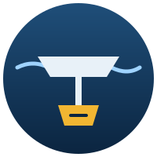

# Ballast

**Locked-yield router for stablecoin capital on DeFi L2s: fixed-rate entries only after cost and risk checks, paper-trading mode.**

Scans Pendle fixed-rate (PT) markets on Arbitrum and Base, lending-market parking rates (DefiLlama, RPC) and dated CEX futures basis.
Computes Net Locked Yield after gas, fees and slippage, scores asset and protocol risk against an incident catalog,
and verifies entries on an Anvil fork. Results go to PostgreSQL and Telegram.

> **Disclaimer.** "Locked" yield holds only if a position is kept to maturity and the underlying asset and protocol stay solvent and pegged.
> All figures produced by this project are estimates or historical results, not promises.

## Features

_Work in progress. See [todo.md](todo.md)._

## Quick start

_Added in Stage 1._

## Architecture

_Added in Stage 1._

## Configuration

Copy `.env.example` to `.env`. Agreed limits and thresholds: [docs/decisions.md](docs/decisions.md).

## Roadmap

1. **Stage 1:** research MVP: data collection, backtest on matured markets, NLY and cost model, risk scoring, fork simulation, paper portfolio, Go/No-Go report.
2. **Stage 2:** production execution with real funds (only after a Go decision).
3. **Stage 3:** admin dashboard and analytics.
